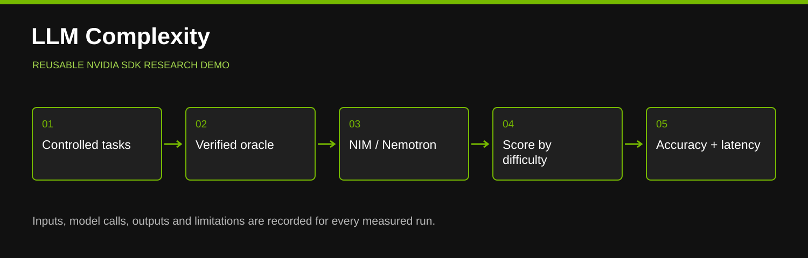

# Reasoning Stress Lab with NVIDIA SDKs

Measure how algorithmic difficulty and input length independently affect NVIDIA NIM responses. Three tasks have exact Python oracles: pointer chasing, modular arithmetic, and type-matched brackets.



## Paper and original project

No public paper or canonical source repository has been verified for this project. This is an explicitly independent controlled-task demonstration, not a claimed reproduction of an unpublished result.

## Quick start

```bash
python -m venv .venv
# Activate .venv using your operating system's standard command.
python -m pip install -e ".[tokenizer]"
python -m project_demo demo --mode fixture --output-dir runs/fixture
python -m project_demo evaluate --output-dir runs/fixture
python -m unittest discover -s tests -v
```

`fixture` performs no model calls. Its deliberately authored outputs test the data flow and metrics; they are never represented as NVIDIA model measurements. For real inference, set `NVIDIA_API_KEY` using your terminal environment or Colab Secrets, then run:

```bash
python -m project_demo demo --config configs/live-smoke.json --mode live --output-dir runs/live
```

The default hosted model is `nvidia/nemotron-3.5-lightning-30b-a3b`. Endpoint availability is checked by actual calls and may depend on your account. Set `NVIDIA_BASE_URL` for your NIM deployment. No errors fall back to fixtures. Each run writes `dataset.jsonl`, `predictions.jsonl`, `metrics.json`, and `run_manifest.json`; live requests have a durable attempt budget that includes failures.

## Interactive tutorials

- [Quickstart in Colab](https://colab.research.google.com/github/virginiakm1988/reasoning-stress-lab/blob/main/notebooks/01_quickstart.ipynb)
- [Evaluation in Colab](https://colab.research.google.com/github/virginiakm1988/reasoning-stress-lab/blob/main/notebooks/02_evaluation.ipynb)
- [English playbook](docs/playbook.md) · [繁體中文快速入門](README.zh-TW.md)

## NVIDIA integration and reuse

NeMo Data Designer 0.9.3 generates structured candidate templates with NVIDIA NIM. Run `python -m project_demo design --mode live --output-dir runs/design` after installing `.[designer]`. Three rows reserve an upper bound of 12 HTTP attempts, including the pinned SDK retry behavior. Inspect generated templates, mark accepted rows `review_status: approved`, then set `variants_path` in the experiment config. Automatic placeholder checks do not replace semantic review. Live experiments use the SHA-256-verified Lightning tokenizer; changing model family requires a verified tokenizer adapter.

## Scientific interpretation

The tasks are synthetic. Success or failure does not prove a complexity class limitation. Small runs have wide uncertainty intervals; the fixed tokenizer controls body tokens, not hidden server chat-template overhead.

See [validation status](docs/validation.md) for exactly what was executed. Saved outputs include provenance and failures. Published paper numbers, authored fixtures and fresh model results are different evidence categories.

## License and attribution

New companion code is Apache-2.0. Third-party data, models and code retain their licenses; see [NOTICE](NOTICE). No model weights or credentials are bundled.

### Recorded NeMo Data Designer execution

The [real SDK run](results/designer-live-v2/templates.jsonl) generated 3 candidate templates; 3 passed structural checks (2 unique valid templates). Every row is still pending human review. Rejected earlier outputs remain in [the first attempt](results/designer-live/templates.jsonl). The NIM baseline results use deterministic task wording; they do not claim to have used unapproved generated templates.
